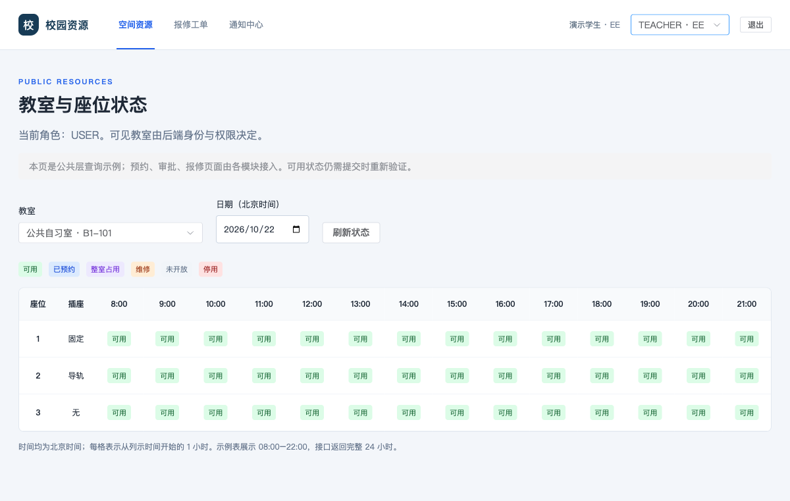
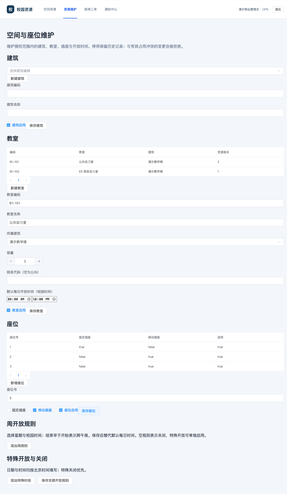

# M1 验证记录

日期：2026-10-22；T06 更新：2026-10-31。关联 [Issue #15](https://github.com/Z11ZEleven/campus-resources-service-platform/issues/15)，分支 `feat/m1-t01-t05-foundation`，起点 `0a5dba2`。本记录由 AI 根据实际命令和浏览器结果整理，不是人工验收或组内评审签字。

## 1. 环境和范围

Python 3.12.9，锁定后端依赖；Node.js 26.12.0（CI 为 Node 22）、锁定前端依赖；MySQL 8.4 独立容器，临时专用 `_test` 数据库。未使用共享开发、测试或生产业务库，未读取真实学生资料。

历史记录（截至 2026-10-31）：实现 T01–T06：工程基础、D 统一会话/身份/授权/服务主体、主数据及开放规则、M1 模型和来源占用明细，以及公共 Outbox、独立 Worker、真实站内通知和受控审计接收。当时尚未实现 T07–T17 的预约、签到及真实 M2/M3 网络写回；后续状态见第 7 节。

## 2. 已执行检查

| 检查 | 实际结果 |
| --- | --- |
| `python -m pytest --require-mysql -q --tb=short` | 2026-10-31 完整后端 **216 passed**；包含既有 M3 回归、T01–T05 与 T06 Outbox/审计测试 |
| `python -m ruff check app scripts tests alembic` | 通过 |
| `python -m alembic check` | No new upgrade operations detected |
| `python -m app.worker --once` | 独立 Worker 启动、领取 0 条、正常退出；连接专用 `_test` 库 |
| `npm run build` | vue-tsc 与 Vite 生产构建通过；资源维护页面独立分块 |
| `git diff --check` | 通过 |
| 文档本地相对链接检查 | 全仓文档 137 个本地相对链接检查通过，截图附件已检查 |

现有锁定依赖有一条 Starlette/httpx TestClient 弃用提示；前端已有大于500KB的公共分块警告。二者不使本轮检查失败，没有用忽略测试或提高阈值掩盖问题。远端 CI 状态须以 GitHub 实际运行结果为准。

## 3. 验证行为

- 会话：有效 Cookie 恢复、退出撤销、过期拒绝、失效身份/角色实时生效、外部 Origin 和缺失 CSRF 拒绝；登录 JSON 不返回 HttpOnly 会话凭据。
- 授权：院系隔离、资源范围查询/计数/维护、不同角色动作和范围不能拼接、M1 本人记录及学生身份适配；SYS_ADMIN 不隐式获得业务权限。
- 服务主体：凭据摘要、模块绑定、房间范围、轮换/停用、审计及幂等配置；初始化管理员与重复种子不会恢复被撤销授权或停用账户。
- 主数据：建筑关系、唯一性、座位不可跨室、软停用、版本/审计；已有有效来源与破坏性维护冲突时明确409。
- 开放：连续完整覆盖、分段空隙、相邻合并、跨午夜、午夜终点、特殊开启/关闭、关闭优先、小时内关闭影响整个可预约槽。
- 模型：非法区间、状态、座位/身份组合归属、重复创建请求键、违约唯一、签到记录归属及不保存提交编码。
- 来源/占用：重复获取不生成重复明细、M2 展开有效座位、释放只更新对应来源明细、维修来源不受个人取消影响，多个维修工单释放仍隔离。
- 迁移：空库到0007、重复升级、模型一致性、从0003携合成来源/释放记录/通知升级、完整测试回放、旧M3资料保留；不虚构旧M1预约。多身份/局部角色不能有损降级为旧结构。
- HTTP：进程健康与真实数据库ready分离、真实拒绝连接时503；业务错误、校验错误、404/405和未知异常均有服务器请求ID与脱敏结构，故障后数据库事务回滚。
- Outbox 登记：同键同载荷幂等、异载荷或业务版本冲突409、业务事务回滚同时撤销任务；事件只在调用方提交后可见。
- 租约与并发：同刻第二个 Worker 领取不到已锁任务；租约过期后可被新 Worker 领取并获得新令牌；旧令牌或旧版本完成操作被拒绝；两个 Worker 并发领取各拿不同事件。
- 崩溃恢复：模拟领取进程未完成且租约到期，另一 Worker 重新领取并成功投递，尝试次数增加且只产生一条通知。
- 重试与故障：瞬时失败写回 `PENDING`/`TRANSIENT` 并按退避延迟；达到上限写 `MANUAL`/`RETRY_EXHAUSTED`；未知处理器和非法载荷写 `MANUAL`/`PERMANENT`；故障查询可列出。
- 接收幂等：通知接收方已提交但 Worker 未完成时，重投仍只有一条站内通知；审计接收方同样只有一条记录，事件最终 `SUCCEEDED`。
- 审计操作者：`SYSTEM` 不填用户 ID，`SERVICE` 使用服务主体 ID，`USER` 必须提供用户 ID；服务主体 ID 未被当作学生用户。
- M1 适配：预约、通知任务、审计任务同一事务登记；提交后 Worker 投递真实站内通知和审计；回滚后预约、通知任务和审计任务均不存在。

## 4. 关键规则破坏性验证

| 临时破坏 | 预期与实际 | 恢复 |
| --- | --- | --- |
| 跳过 Cookie CSRF 判定 | 原本应403的退出变为200，针对性测试失败 | 恢复后会话测试通过 |
| 完整区间覆盖改为只查起点 | 两项开放区间测试失败 | 恢复后三项纯区间测试通过 |
| 隔离副本迁移移除预约正区间 CHECK | 非法等长区间被接收，测试报 DID NOT RAISE | 恢复迁移约束后测试及一致性检查通过 |
| 移除 Outbox 完成操作的期望版本条件 | 旧令牌/旧版本的完成操作本应 `LeaseLost`，实际未抛出，针对性测试报 DID NOT RAISE | 恢复后 14 项 Outbox 测试通过 |
| 将审计去重插入改为普通插入 | 重投命中 `uq_log_module_event` 重复键，事件进入 `MANUAL`；补足 Outbox 状态断言后测试报 `MANUAL != SUCCEEDED` | 恢复去重插入后审计重投幂等测试通过 |

破坏实验使用独立测试进程/数据库，恢复原实现，没有把故意破坏写入提交。

## 5. 浏览器验证与截图

使用 Playwright CLI、真实 Vite → FastAPI → MySQL 链路和虚构种子用户。初次未登录的 /auth/me 401 是恢复探测的正常拒绝，不作为已认证错误。

实际浏览器验证：student 登录后读取真实教室；刷新仍保留会话；切换到本人 TEACHER/EE 身份后院系展示及查询更新；退出后回到 /login。property_admin 登录打开资源维护，选择 B1-101 的座位3，启用移动插座并保存；随后以独立数据库查询确认属性持久化、resource_version 递增和 SAVE_SEAT 审计存在；再次退出正常回到 /login。

截图已逐张检查：

Markdown 已生成 HTML 并检查表格、标题与正文渲染。不使用 HTTP TestClient 冒充浏览器或真实跨模块网络链路。

## 6. 未决与交付约束

用户已确认人员分工尚未确定，并授权直接实作；[责任登记表](../team.md) 保留真实待定状态。T01 的登记交付完成不表示人员已落实；相关成员共同评审、人工验收和合并仍未完成。AI 不创建这些虚假记录。

历史状态：T06 只验证公共任务与接收基础设施。T09 现已登记预约定时任务、T10 已实现签到；T11 的定时通知和违约处理仍未实现。维修免责取消/中断、M3 局部业务授权、占用明细后续重算、M2/M3 真实 HTTP 来源接口仍属于后续任务。新资源维护遇有效来源采用409，来源保留，不静默覆盖。

通知当前是真实站内收件箱，不是邮件或微信外部通道；Worker 故障仅有服务层查询和日志，没有管理 HTTP 页面、指标或告警。多个 Worker 已做并发验证，但未做多主机网络分区和长时间运行验证。审计迁移降级在存在 `SYSTEM`/`SERVICE` 行时会因恢复 `actor_id` 非空而失败，正式发布优先前向修复并人工处理破坏性降级。升级旧 JWT 客户端必须重新登录。本轮不执行生产发布或合并 main。

## 7. 2026-11-11 后端与构建检查

以下为本次独立检查的证据，适用于检查时工作区，不代表组内评审、人工验收、生产环境验证或真实 M2/M3 网络链路。MySQL 8.4 独立实例使用专用 `_test` 数据库，运行前通过环境变量 `TEST_DATABASE_URL` 配置连接；不在本文记录连接串或凭据。

| 工作目录与命令 | 结果 |
| --- | --- |
| `backend/`：`.venv/bin/python -m pytest --require-mysql -q` | **281 passed**；1 条 Starlette 弃用警告 |
| `backend/`：`.venv/bin/python -m ruff check app scripts tests alembic` | 通过 |
| `backend/`：`.venv/bin/python -m alembic check` | No new upgrade operations detected；退出码 0 |
| `frontend/`：`npm run build` | 通过；存在 large chunk 警告 |

检查覆盖当前后端测试集，包括 T08 搜索、T09 预约及 T10 签到相关测试；不能据此推断未运行的浏览器验收或真实跨模块网络验收。数据库迁移至 0010；授权 `rotate` 的受控步骤及回退风险见 [契约](contracts.md)。T11 处理器尚未注册，`m1_timer` 任务保持 PENDING，实际提醒、违约、自动结束与接管策略仍待实现。T07 资源裁决内核已实现，版本墓碑和来源乱序规则由 0008、资源服务及 `test_resources` 覆盖；T08 搜索及独立管理员时段限制来源已实现，搜索与创建共享可预约判定。T12 HTTP 操作记录与核对、真实网络入口和维修免责联动，以及 T11–T17 和人工验收未完成。

已知限制：维修开始后，既有预约目前仍可能签到；维修免责取消或中断及签到联动尚待 T12/T13 实现和验证。

## 8. T08 独立审查与最终验证（2026-11-11）

本轮完成 AI 独立代码审查与修正复查，不代替团队评审或人工验收。发现并修复：0011 在 MySQL DDL 中断后无法重跑；管理员等待房间锁后仍使用旧会话和权限。0011 现在保留已存在的请求表，并以单条原子 ALTER 恢复来源约束；创建和释放限制均在锁内重新校验会话、身份、动作与范围。修正恢复测试自身的模块加载和 CHECK 语法，避免测试清理失败遗留缺失约束。

最终在 MySQL 8.4 专用 `campus_resources_test` 库执行（连接由测试环境配置，未记录凭据）：

| 命令（backend/） | 实际结果 |
| --- | --- |
| `.venv/bin/python -m pytest --require-mysql -q --tb=short` | **295 passed**，1 条既有 Starlette 弃用警告 |
| `.venv/bin/python -m ruff check app scripts tests alembic` | 通过 |
| `.venv/bin/python -m alembic check` | No new upgrade operations detected |
| `.venv/bin/python -m pytest --require-mysql tests/test_admin_restrictions.py tests/test_admin_migration_recovery.py -q` | **14 passed** |
| 仓库根目录 `git diff --check` | 通过 |

破坏验证：暂时移除创建／释放限制的锁后主体刷新，4 项会话／角色撤销测试全部失败；恢复原实现后上述 14 项全部通过。迁移修复前，三种中断恢复测试均失败；修复后全部通过。临时破坏均已恢复，未提交。最终完整回归包括三种中断状态、旧数据保留、空库回放、降级保护及原 M3 回归。

T07–T10 后端工程交付已完成，T08 清单已勾选。公共 schema、接口与限制冲突政策仍待相关负责人及团队评审；没有代签人工验收。前端未修改，本轮未重跑浏览器或前端构建，先前结果保留于第 7 节。T11 起自动提醒、违约和维修联动不在本轮范围；维修开始后既有预约仍可能签到。真实跨模块 HTTP 链路、管理前端及生产发布均未完成。
