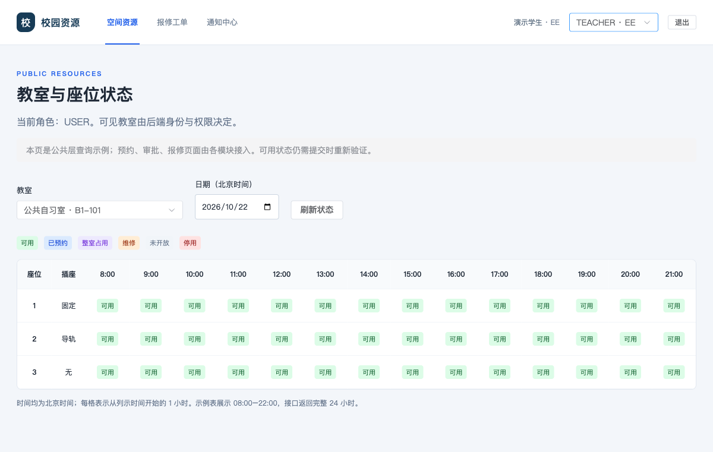
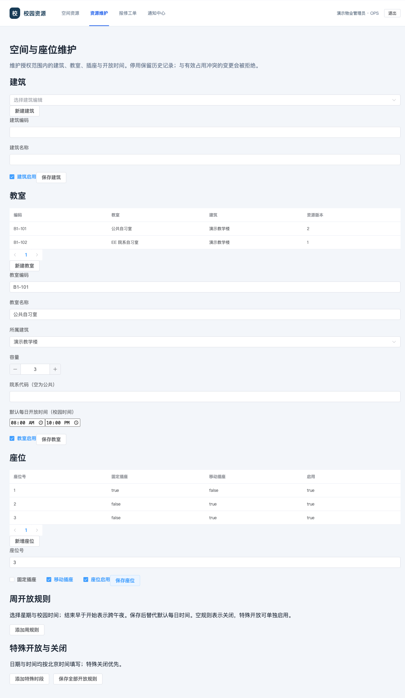

# M1 T01–T05 验证记录

日期：2026-10-22。关联 [Issue #15](https://github.com/Z11ZEleven/campus-resources-service-platform/issues/15)，分支 `feat/m1-t01-t05-foundation`，起点 `0a5dba2`。本记录由 AI 根据实际命令和浏览器结果整理，不是人工验收或组内评审签字。

## 1. 环境和范围

Python 3.12.9，锁定后端依赖；Node.js 26.12.0（CI 为 Node 22）、锁定前端依赖；MySQL 8.4 独立容器，临时专用 `_test` 数据库。未使用共享开发、测试或生产业务库，未读取真实学生资料。

本轮实现 T01–T05：工程基础、D 统一会话/身份/授权/服务主体、主数据及开放规则、M1 模型和来源占用明细。没有实现 T06–T17 的预约、签到、通知任务及真实 M2/M3 网络写回。

## 2. 已执行检查

| 检查 | 实际结果 |
| --- | --- |
| `python -m pytest --require-mysql -q --tb=short` | 完整后端 201 passed；包含既有 M3 回归与新基础测试 |
| `python -m ruff check app scripts tests alembic` | 通过 |
| `python -m alembic check` | No new upgrade operations detected |
| `npm run build` | vue-tsc 与 Vite 生产构建通过；资源维护页面独立分块 |
| `git diff --check` | 通过 |
| 文档本地相对链接检查 | 55 个本地相对链接检查通过，截图附件已检查 |

现有锁定依赖有一条 Starlette/httpx TestClient 弃用提示；前端已有大于500KB的公共分块警告。二者不使本轮检查失败，没有用忽略测试或提高阈值掩盖问题。远端 CI 状态须以 GitHub 实际运行结果为准。

## 3. 验证行为

- 会话：有效 Cookie 恢复、退出撤销、过期拒绝、失效身份/角色实时生效、外部 Origin 和缺失 CSRF 拒绝；登录 JSON 不返回 HttpOnly 会话凭据。
- 授权：院系隔离、资源范围查询/计数/维护、不同角色动作和范围不能拼接、M1 本人记录及学生身份适配；SYS_ADMIN 不隐式获得业务权限。
- 服务主体：凭据摘要、模块绑定、房间范围、轮换/停用、审计及幂等配置；初始化管理员与重复种子不会恢复被撤销授权或停用账户。
- 主数据：建筑关系、唯一性、座位不可跨室、软停用、版本/审计；已有有效来源与破坏性维护冲突时明确409。
- 开放：连续完整覆盖、分段空隙、相邻合并、跨午夜、午夜终点、特殊开启/关闭、关闭优先、小时内关闭影响整个可预约槽。
- 模型：非法区间、状态、座位/身份组合归属、重复创建请求键、违约唯一、签到记录归属及不保存提交编码。
- 来源/占用：重复获取不生成重复明细、M2 展开有效座位、释放只更新对应来源明细、维修来源不受个人取消影响，多个维修工单释放仍隔离。
- 迁移：空库到0006、重复升级、模型一致性、从0003携合成来源/释放记录/通知升级、完整测试回放、旧M3资料保留；不虚构旧M1预约。多身份/局部角色不能有损降级为旧结构。
- HTTP：进程健康与真实数据库ready分离、真实拒绝连接时503；业务错误、校验错误、404/405和未知异常均有服务器请求ID与脱敏结构，故障后数据库事务回滚。

## 4. 关键规则破坏性验证

| 临时破坏 | 预期与实际 | 恢复 |
| --- | --- | --- |
| 跳过 Cookie CSRF 判定 | 原本应403的退出变为200，针对性测试失败 | 恢复后会话测试通过 |
| 完整区间覆盖改为只查起点 | 两项开放区间测试失败 | 恢复后三项纯区间测试通过 |
| 隔离副本迁移移除预约正区间 CHECK | 非法等长区间被接收，测试报 DID NOT RAISE | 恢复迁移约束后测试及一致性检查通过 |

破坏实验使用独立测试进程/数据库，恢复原实现，没有把故意破坏写入提交。

## 5. 浏览器验证与截图

使用 Playwright CLI、真实 Vite → FastAPI → MySQL 链路和虚构种子用户。初次未登录的 /auth/me 401 是恢复探测的正常拒绝，不作为已认证错误。

实际浏览器验证：student 登录后读取真实教室；刷新仍保留会话；切换到本人 TEACHER/EE 身份后院系展示及查询更新；退出后回到 /login。property_admin 登录打开资源维护，选择 B1-101 的座位3，启用移动插座并保存；随后以独立数据库查询确认属性持久化、resource_version 递增和 SAVE_SEAT 审计存在；再次退出正常回到 /login。

截图已逐张检查：

Markdown 已生成 HTML 并检查表格、标题与正文渲染。不使用 HTTP TestClient 冒充浏览器或真实跨模块网络链路。

## 6. 未决与交付约束

用户已确认人员分工尚未确定，并授权直接实作；[责任登记表](../team.md) 保留真实待定状态。T01 的登记交付完成不表示人员已落实；相关成员共同评审、人工验收和合并仍未完成。AI 不创建这些虚假记录。

M1 业务API、维修免责取消/中断、M3 局部业务授权、占用明细后续重算、M2/M3 真实HTTP来源接口仍属于后续任务。新资源维护遇有效来源采用409，来源保留，不静默覆盖。升级旧JWT客户端必须重新登录。正式部署应备份并验证迁移，优先前向修复；本轮不执行生产发布或合并 main。
