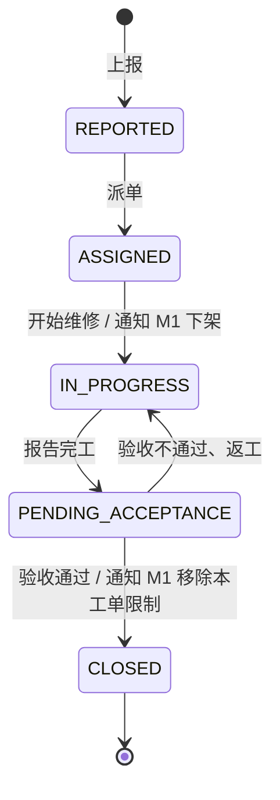
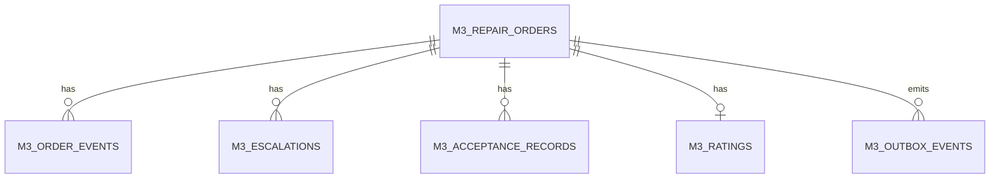

# M3 物业报修工单：需求、建模与接口设计（讨论稿）

> 依据：课程 PJ 任务书第 1—5 页。本文区分任务书的明确要求与建议实现，供组内讨论和第一次 Review 使用；接口路径、角色名称、超时时长须与 M1、D 的负责人共同确认。

## 1. 功能边界：M3 负责什么

任务书明确要求 M3 覆盖**故障上报、派单、维修中状态、超时升级、完工验收与评价**。同时，M3 与 M1 存在强制集成：某自习室有维修中的工单时，该室全部座位应从可预约列表下架；工单验收通过后自动恢复。M1 必须保留状态写入来源，以供追溯。组内还应讨论是否存在其他集成点。

建议将 M3 定义为**工单及维修过程的事实来源**，把房间、人员身份、角色权限等公共数据交给 D 管理；M1 负责计算座位是否可预约。M3 通过公开的模块接口通知 M1 增减维修限制，不直接改 M1 的数据库或座位字段。

| 能力与数据 | 归属 | M3 的边界 |
|---|---|---|
| 工单、派单、维修、验收、评价、超时升级及过程记录 | **M3** | 拥有状态机和工单数据，提供业务接口与审计证据 |
| 用户身份、角色权限、房间／座位主数据、公共通知 | **D** | M3 引用 D 的稳定 ID 并验证权限，不自行维护另一份用户或房间主表 |
| 座位搜索、个人预约、座位可预约性与状态来源 | **M1** | M3 只写入／移除“某工单要求整个房间维修下架”的限制，不直接改座位或个人预约 |
| 整教室审批占用 | **M2，经 M1 汇合** | M3 与 M2 暂不需要直接调用；M1 负责合并各来源的限制 |

建议提供的 M3 界面包括报修人“上报／查看进度／评价”、物业人员“待派单／超时工单”、维修人员“我的工单／开工／完工”、验收人“待验收”。这些是使用角色与页面建议，任务书未限定页面数或角色名称。故障图片、定位到具体座位、取消工单可作为后续能力；**房间级下架**是任务书规定的跨模块效果。

## 2. 需求分析与验收

### 功能需求

| 编号 | 用户故事及最小验收条件 | 来源 |
|---|---|---|
| M3-01 | 有权限的用户选择有效房间、填写故障描述并提交；能获得工单号和当前状态；无效房间或缺少必要内容被拒绝。 | 任务书：故障上报；具体字段是建议 |
| M3-02 | 物业负责人可将工单分派给维修人员；能查询待处理与本人负责的工单。 | 任务书：派单；角色划分是建议 |
| M3-03 | 维修人员开始处理后工单进入维修中；M1 不再提供该房间的可预约座位，并显示限制来源为该工单。 | 任务书：维修中及 M3→M1 联动 |
| M3-04 | 维修人员提交处理结果后进入待验收；验收通过才解除该工单带来的维修限制；验收未通过则继续处理。 | 任务书：完工验收、验收后恢复；驳回返工是建议 |
| M3-05 | 验收后可对本次维修评价；非相关人员不能篡改评价。 | 任务书：评价；权限边界是建议 |
| M3-06 | 超过约定处理时限的工单能自动升级，留下升级时间、原因和接收人，并避免同一超时反复升级。 | 任务书：超时升级；时限须组内定 |
| M3-07 | 工单的关键状态变化可追溯：谁、何时、因何操作，以及向 M1 写入或移除限制的结果。 | 任务书：操作审计、集成追溯 |

任务书附加项中的自然语言 Agent 提及“取消工单”，但基础 M3 功能清单未明确要求取消。若组内打算实现，应先约定允许取消的状态和权限，并防止已开始维修的工单被随意取消。

### 角色与权限（提议，须与 D 对齐）

| 角色 | 可执行操作 | 需要定下的规则 |
|---|---|---|
| 报修人 | 上报、查看自己有权查看的工单、在允许时评价 | 学生／教师／管理员是否都能上报；能否查看同室他人的工单 |
| 物业派单人 | 查看待处理、指派维修人、查看超时升级 | 谁能修改负责人和时限；重新派单如何留下记录 |
| 维修人 | 查看本人任务、开始维修、报告完工 | 能否拒单、能否转派；越权状态跳转必须拒绝 |
| 验收人 | 验收通过或退回返工 | 由报修人、房间管理员还是物业主管验收，任务书未规定 |
| 系统定时任务 | 检测超时、生成升级与通知请求 | 只通过受控服务身份执行，不伪装成人工操作者 |

### 关键业务规则与非功能要求

- **状态合法：**每个动作有前置状态和授权条件；同一工单的并发操作只允许一个按预期版本成功，失败方重新读取状态。
- **时限可检查：**从哪一刻开始计时、按什么时长升级、升级给谁，由组内配置并写成验收标准；任务书只规定“超时升级”，没有给具体小时数。
- **限制可追溯：**M3 工单与 M1 房间限制一一对应；同室多张有效工单、M2 占用、M1 个人预约不得互相覆盖。已有预约遇到维修下架时如何处理，须与 M1 决策。
- **失败可恢复：**M1 或 D 暂时不可用时，操作结果、待同步事件和失败原因可查；重复请求、任务重试不会重复派单、升级或释放其他工单的限制。
- **权限与隐私：**工单描述和照片可能包含个人信息，查询按角色与范围过滤；关键动作留痕，不把用户可控制的 `actorId` 当作真实操作者。
- **可交付性：**迁移脚本、配置样例、自动化测试、接口契约和失败复现方式纳入版本管理。项目技术栈与部署方式由组内确定。

## 3. 领域模型与状态

### 核心对象

| 对象 | 关键字段（建议） | 责任 |
|---|---|---|
| `RepairOrder` 工单 | `id`、`roomId`、`reporterId`、`faultType`、`description`、`priority`、`status`、`assigneeId`、`createdAt`、`dueAt`、`startedAt`、`finishedAt`、`acceptedAt`、`version` | M3 保存工单与当前状态；`roomId` 引用 D 的房间 ID |
| `OrderTransition` 状态记录 | `orderId`、`fromStatus`、`toStatus`、`actorId`、`reason`、`at`、`requestId` | M3 保存不可随意覆盖的过程证据 |
| `Escalation` 升级记录 | `orderId`、`level`、`triggeredAt`、`reason`、`notifiedTo` | M3 记录超时升级；升级等级不替代工单状态 |
| `Acceptance` 验收记录 | `orderId`、`result`、`inspectorId`、`comment`、`at` | M3 保存通过或不通过的依据 |
| `Rating` 评价 | `orderId`、`score`、`comment`、`authorId`、`at` | M3 保存评价，规则由组内确定 |

故障照片、具体座位编号可作为可选字段。**下架范围按任务书以整个自习室为单位**，即使故障记录了具体座位，也不能自行将强制联动缩小到单个座位。



**建议的业务规则：**从进入 `IN_PROGRESS` 到验收通过之前，包括 `PENDING_ACCEPTANCE`，该工单持续占用一个“维修限制”。这样完工但尚未验收时座位不会提前开放。超时升级是工单上的独立记录，不直接改变上述主状态。非法状态跳转返回冲突错误，并记录相应操作人。

对象关系为：一张工单对应多条状态记录、多次可能的升级和验收尝试；验收通过后最多保留一条有效评价。`roomId`、`reporterId`、`assigneeId`、`inspectorId` 均引用 D 的业务 ID。若 D 与 M3 分库，不能跨数据库建立物理外键，应通过接口校验并保存 ID 快照。

## 4. 数据库对象与表设计

下表给出**逻辑模型**，不预设 PostgreSQL、MySQL 或 ORM。主键推荐使用 UUID 或全组统一的 ID 方案；时间使用带时区的时间戳并统一存储规则。具体 SQL 类型和迁移命名随技术栈确定。

| 表 | 关键列与约束（建议） | 为什么需要 |
|---|---|---|
| `m3_repair_orders` | `id` PK；`room_id`、`reporter_id`、`fault_type`、`description`、`priority`、`status`、`assignee_id?`、`dispatch_due_at?`、`repair_due_at?`、`started_at?`、`finished_at?`、`accepted_at?`、`escalation_level`、`version`、`created_at`、`updated_at` | 保存工单当前快照；`room_id/status`、`assignee_id/status`、`repair_due_at/status` 建索引；`version` 防并发覆盖 |
| `m3_order_events` | `id` PK；`order_id` FK；`event_type`、`from_status?`、`to_status?`、`actor_id?`、`reason?`、`request_id?`、`occurred_at` | 追加记录状态、派单、返工及人工动作；按 `order_id, occurred_at` 查询，不以修改当前行代替历史 |
| `m3_escalations` | `id` PK；`order_id` FK；`sla_cycle`、`level`、`due_at`、`triggered_at`、`recipient_id`、`reason`；唯一约束 `(order_id, sla_cycle, level)` | 保存每次超时升级和去重依据；返工后如重新计时，使用新周期 |
| `m3_acceptance_records` | `id` PK；`order_id` FK；`attempt_no`、`result=PASS/REJECT`、`inspector_id`、`comment?`、`created_at`；唯一约束 `(order_id, attempt_no)` | 验收不通过时保留历次尝试，不能只覆盖最后结果 |
| `m3_ratings` | `order_id` PK/FK；`rater_id`、`score`、`comment?`、`created_at`、`updated_at?`；`score` 做范围校验 | 每张已验收工单一条评价；是否允许修改由组内确定 |
| `m3_outbox_events` | `id` PK；`order_id` FK；`event_type`、`payload`、`idempotency_key` UNIQUE、`delivery_status`、`attempt_count`、`next_retry_at?`、`created_at`、`delivered_at?` | 推荐的可靠集成机制：在本地事务中记录向 M1 添加／移除限制的意图，失败后重试并留下状态 |



最小第一轮可以先做 `m3_repair_orders` 与 `m3_order_events`，同时定义其余表的迁移顺序；要真实打通 M1 时必须补齐可靠投递和验收记录。故障图片如需要，增加仅保存文件地址与元数据的 `m3_attachments`，不要把图片二进制或密钥直接写入工单表。房间、座位、用户、角色、通知主数据归 D，座位可预约状态归 M1，M3 不复制。

从空库到当前版本的所有 M3 迁移须能按顺序一次重放；开发和测试环境使用脚本化、幂等的种子数据，与真实业务数据分离。迁移脚本和运行命令随代码提交，不手工改库。

## 5. M3 对外提供的接口（建议契约）

以下用 HTTP API 表达能力，具体 URL、字段风格和鉴权方案以全组统一约定为准。所有写操作须通过 D 的身份与权限校验，服务端自行取操作人身份，不信任请求体中的 `actorId`。

| 接口 | 主要请求内容 | 返回及行为 |
|---|---|---|
| `POST /api/v1/repair-orders` | `roomId, faultType, description, priority?` | 创建工单，返回 `id, status=REPORTED` |
| `GET /api/v1/repair-orders` | `status?, roomId?, mine?, page?` | 按权限查询；普通用户只看获授权工单 |
| `GET /api/v1/repair-orders/{id}` | 工单 ID | 返回详情、状态与可见的处理历史 |
| `POST /api/v1/repair-orders/{id}/dispatch` | `assigneeId, dueAt?` | 仅授权派单人可操作，进入 `ASSIGNED` |
| `POST /api/v1/repair-orders/{id}/start` | `note?` | 仅指定维修人可操作，进入 `IN_PROGRESS` 并触发 M1 下架 |
| `POST /api/v1/repair-orders/{id}/finish` | `repairSummary` | 进入 `PENDING_ACCEPTANCE`，房间仍受限 |
| `POST /api/v1/repair-orders/{id}/acceptance` | `result=PASS/REJECT, comment?` | 通过后关闭并移除本工单的 M1 限制；不通过则返工 |
| `POST /api/v1/repair-orders/{id}/rating` | `score, comment?` | 对已验收工单评价；避免重复提交或明确修改规则 |
| `GET /api/v1/repair-orders/{id}/history` | 工单 ID | 返回审计记录和升级记录 |

建议错误语义：`400` 字段错误，`401/403` 未登录或无权限，`404` 工单／房间不存在，`409` 状态不允许或并发版本冲突。创建操作使用幂等键，状态写操作带预期版本，可防重复请求与两人同时操作。

建议所有工单详情至少返回 `id, roomId, status, reporterId, assigneeId, createdAt, updatedAt, version`；有权限的管理端还可见 `integrationStatus` 和过程历史。列表接口提供分页，不一次返回全库。以下只是**契约样例**，房间 ID 和故障分类以 D／组内最终约定为准：

```http
POST /api/v1/repair-orders
Idempotency-Key: example-report-001
Content-Type: application/json

{"roomId":"ROOM-101","faultType":"EQUIPMENT","description":"照明故障"}

201 Created
{"id":"ORDER-001","roomId":"ROOM-101","status":"REPORTED","version":1}
```

对 `/start`、`/finish`、`/acceptance` 等写操作，客户端可传预期版本，服务端以事务执行“检查当前状态和权限 → 更新工单 → 追加过程记录 → 写入待同步事件”。例如 `POST /{id}/acceptance` 的 `result=PASS` 对应 `PENDING_ACCEPTANCE → CLOSED`，`result=REJECT` 对应 `PENDING_ACCEPTANCE → IN_PROGRESS`；具体可操作人由 D 的权限契约决定。

超时升级由 M3 的定时任务扫描 `dueAt` 等期限并写入 `Escalation`，通知功能交给 D；**具体 SLA 时长、升级对象和次数由小组确定**，任务书未给数字。

## 6. 与 M1、D 的接口及一致性

### M3 → M1：按工单维护房间维修限制

建议由 M1 提供两个幂等的内部接口：

| 时机 | M3 调用 M1 | M1 的责任 |
|---|---|---|
| 工单进入维修中 | `PUT /internal/v1/rooms/{roomId}/maintenance-holds/{orderId}`，携带 `source=M3_REPAIR`、发生时间 | 保存该工单对应的一条房间限制；从可预约查询排除房间全部座位，记录来源 |
| 工单验收通过 | `DELETE /internal/v1/rooms/{roomId}/maintenance-holds/{orderId}` | 仅移除该工单的限制，再重新计算座位可预约性 |

**不要用单个 `room.unavailable=true/false` 字段表达联动。**同一房间可能有两张同时维修的工单；第一张验收后，第二张仍要求房间下架。即使全部维修限制解除，M2 的整教室占用或 M1 自身预约也可能仍使座位不可预约。“恢复”指撤销 M3 的限制来源，而不是强行将所有座位设为可预约。

M3 本地状态已保存而 M1 调用失败时，需要留下“待同步”状态并重试；重复 `PUT/DELETE` 不应产生额外影响。**同一工单的添加／移除消息还须按业务版本有序处理**，避免旧的添加请求在验收移除后重试，把房间错误地再次下架。M3 的接口需明确显示同步状态，不能把“工单已转为维修中”误报为“M1 已成功下架”。真实使用前还须决定同步时限与失败时是否阻止后续预约，以免短暂出现仍可预约的窗口。第一次 Review 可以先定接口并在 M3 用契约测试验证；第二次 Review 前应通过真实网络调用验证完整链路。组内还须决定已有预约遇到新维修限制时如何处理和通知，任务书没有给出具体策略。

### M3 ↔ D：公共能力

- **空间主数据：**上报时校验 `roomId` 是否存在、是否允许报修；D 定义房间 ID 和有效状态。
- **身份与权限：**D 提供统一身份、角色和权限规则；M3 检查“上报、派单、维修、验收、评价”各动作的授权。
- **通知与审计：**M3 提供业务事件与操作上下文，D 的通知服务向维修人、报修人及升级接收人发送通知；M3 自身保留可追溯的状态记录。

需要和 D 负责人确定这些能力采用同步 API、消息事件还是统一组件，尤其是身份来源及房间 ID 契约。M3 与 M2 暂无任务书规定的直接调用；两者对座位的影响均由 M1 统一计算。

## 7. M3 模块结构（技术栈无关）

如果全组采用单仓库，可先把 M3 作为独立目录或包；如果采用多服务部署，同样保留这些职责分层。下述名称是建议，不限定 Java、TypeScript 或其他语言：

```text
modules/m3/
  api/              HTTP 路由、请求与响应 DTO、身份入口、错误映射
  application/      上报、派单、开工、完工、验收、评价、升级等用例；事务编排
  domain/           工单实体、合法状态转换、SLA 与权限相关业务规则
  ports/            OrderRepository、RoomCatalog、Identity、MaintenanceHold、Notification
  infrastructure/   数据库仓储、D/M1 客户端、Outbox 投递器、超时扫描任务
  migrations/       版本化表结构迁移与独立种子数据
  tests/            状态单测、仓储测试、接口测试、M1/D 契约与集成测试
```

请求流为 `界面／调用方 → api → application → domain`；`application` 通过 `ports` 调用数据库和其他模块，不直接在路由中拼 SQL 或修改 M1 表。后台超时任务也走同一应用用例；外部联动先记本地待投递事件，再由投递器调用 M1／D。部署时 M3 需要明确数据库连接、D 与 M1 地址、服务凭证、SLA 配置和定时任务开关，这些配置应提供样例，真实密钥不入库。

建议把 `api/` 的公开接口、`ports/MaintenanceHold` 的跨模块契约、迁移脚本和测试作为可独立评审的文件。这样 M1／D 负责人可以先确认接口，M3 再逐步实现内部逻辑。

## 8. 最少要验证的场景

1. 有效上报、无效房间、缺字段、无权限操作。
2. 上报 → 派单 → 开始维修 → 完工 → 验收通过 → 评价；每步状态和审计记录正确。
3. 进入维修中后，M1 的该房间全部座位不可预约，且查询能追溯到 M3 工单。
4. 维修完工但尚未验收、验收被驳回时，M1 限制仍存在；验收通过才移除。
5. 同室两张维修工单：只验收一张不能恢复房间；M2 仍占用时移除维修限制也不能允许个人预约。
6. M1 接口暂时失败或重复请求时，最终限制状态正确，不丢失、不重复。
7. 超时自动升级只触发一次预期级别；故意破坏状态判断或限制写回逻辑时，相关测试应失败。

| 需求 | 主要实现位置 | 最关键的验证 |
|---|---|---|
| M3-01 | 创建／查询 API，`repair_orders` | 有效上报、无效房间、越权与重复提交 |
| M3-02 | 派单用例，`repair_orders`＋`order_events` | 指派权限与状态前置条件 |
| M3-03 | 开工用例，`outbox_events`，M1 限制接口 | 房间全部座位下架、来源正确、调用失败可重试 |
| M3-04 | 完工／验收用例，`acceptance_records`＋`outbox_events` | 待验收不释放、驳回返工、验收通过后只释放本工单 |
| M3-05 | 评价 API，`ratings` | 仅允许授权评价、分数范围和重复评价规则 |
| M3-06 | 定时任务，`escalations` | 超时触发、未超时不触发、重复扫描不重复升级 |
| M3-07 | 历史查询，`order_events`＋投递状态 | 操作者、状态变更及 M1 同步结果可追溯 |

## 9. 第一次 Review 前的 M3 工作包

| 优先级 | 本周可交付内容 |
|---|---|
| 必须先定 | 和 D、M1 负责人确认房间 ID、身份权限、维修限制接口、验收人；把尚未确定之处登记为风险或待决策项 |
| 文档与规则 | 把上述用户故事登记进全组需求基线，画状态图与模块依赖图，写明第一轮任务的 AI 委派范围和验收条件 |
| 第一次迭代 | 建立 M3 服务、版本化 schema 迁移、工单创建／查询／派单／开始维修的最小实现和关键测试 |
| 现场可展示 | 一次从上报到维修中的真实运行、对应提交和测试结果；如 M1 尚未接通，明确展示接口契约测试并标记真实集成为未完成 |

**带到讨论课的重点问题：**谁可以验收、超时升级阈值如何定、已有预约遇到维修下架如何处理、多个限制来源如何合并、M1 调用失败时何时认为联动完成。这些问题需要全组共同决策，M3 不应单独替其他模块决定。
