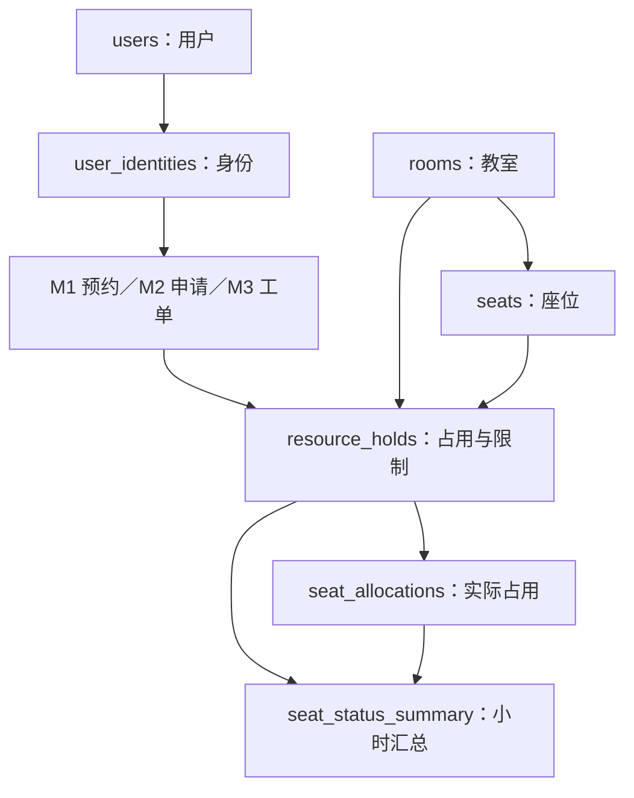

# 校园资源服务平台：公共层数据库表设计（全概览版，非精简）

版本：v0.1（小组评审草案）  
日期：2026-10-20  
范围：公共层 D 的 25 张表，其中 2 张可选；六张核心表优先展开。  
说明：沿用本次讨论的表名和框架，补齐通用字段、可空性、关联与约束。默认值、状态细节及责任归属均为建议，未执行建库或建表操作。

## 1. 统一约定

| 项目 | 约定 |
|---|---|
| 数据库与命名 | PostgreSQL；公共层使用 d schema，业务表分别使用 m1、m2、m3 schema |
| 主键 | UUID；服务端统一生成，所有表逐项列出 id |
| 时间 | TIMESTAMPTZ；接口带时区，页面按 Asia/Shanghai 展示 |
| 时间区间 | [start_at, end_at)，开始包含、结束不包含；end_at 为 NULL 时仅在允许的业务中表示未确定终点 |
| 公共字段 | 所有表有 id、created_at；可修改表有 updated_at、version；本稿逐表展开 |
| 版本区分 | version 是本行更新版本；rooms.availability_version 是资源规则版本；holds.revision 是来源事件版本，三者不可混用 |
| 主数据历史 | 用户、院系、建筑、教室、座位优先停用/归档；外键默认限制物理删除，删除策略另行评审 |
| 数据维护 | 每表一个维护方；跨模块通过公开接口执行操作，不因共享数据库而任意修改他组表 |
| 外键边界 | 同库可使用跨 schema 外键；独立数据库部署时改为逻辑关联与接口验证 |
| 跨表规则 | 字段约束之外，状态转换、所属关系、权限、并发和失败恢复由业务事务或受控数据库逻辑实现 |
| 安全 | 不保存明文密码或令牌；敏感联系方式、附件与审计日志实施访问控制 |
| 本稿中的“无” | 没有默认值，写入方必须显式提供；不是字符串内容 |

## 2. 公共表总览

| 编号 | 完整表名 | 作用 | 建议维护子域 | 级别 |
|---|---|---|---|---|
| D01 | `d.users` | 用户主表 | 身份与权限 | 核心 |
| D02 | `d.user_identities` | 用户身份表 | 身份与权限 | 核心 |
| D03 | `d.auth_accounts` | 登录认证账号表 | 身份与权限 | 配套 |
| D04 | `d.auth_sessions` | 登录会话表 | 身份与权限 | 可选 |
| D05 | `d.departments` | 院系部门表 | 身份与权限 | 配套 |
| D06 | `d.roles` | 角色表 | 身份与权限 | 配套 |
| D07 | `d.permissions` | 权限表 | 身份与权限 | 配套 |
| D08 | `d.role_permissions` | 角色权限关联表 | 身份与权限 | 配套 |
| D09 | `d.user_roles` | 用户角色关联表 | 身份与权限 | 配套 |
| D10 | `d.user_role_scopes` | 角色数据范围表 | 身份与权限 | 配套 |
| D11 | `d.buildings` | 建筑表 | 空间与资源 | 配套 |
| D12 | `d.rooms` | 教室主表 | 空间与资源 | 核心 |
| D13 | `d.seats` | 座位主表 | 空间与资源 | 核心 |
| D14 | `d.room_opening_rules` | 周期开放规则表 | 空间与资源 | 配套 |
| D15 | `d.room_opening_exceptions` | 特殊开放规则表 | 空间与资源 | 配套 |
| D16 | `d.resource_holds` | 资源占用与限制来源表 | 空间与资源 | 核心 |
| D17 | `d.seat_allocations` | 座位实际占用明细表 | 空间与资源 | 配套 |
| D18 | `d.seat_status_summary` | 座位状态汇总表 | 空间与资源 | 核心 |
| D19 | `d.system_settings` | 系统配置表 | 公共配置 | 配套 |
| D20 | `d.notification_templates` | 通知模板表 | 通知服务 | 配套 |
| D21 | `d.notifications` | 通知消息表 | 通知服务 | 配套 |
| D22 | `d.notification_deliveries` | 通知投递记录表 | 通知服务 | 配套 |
| D23 | `d.audit_logs` | 公共操作审计表 | 操作审计 | 配套 |
| D24 | `d.outbox_events` | 可靠外部任务表 | 公共基础设施＋各模块处理器 | 配套 |
| D25 | `d.files` | 文件元数据表 | 文件服务 | 可选 |

## 3. 六张核心表

### D01：`d.users` 用户主表

| 字段 | 类型 | 可空 | 建议默认值 | 主外键／关联 | 含义 |
|---|---|---|---|---|---|
| `id` | UUID | 否 | 服务端生成 | PK | 全局唯一记录 ID |
| `created_at` | TIMESTAMPTZ | 否 | 创建时刻 | — | 创建时间 |
| `display_name` | VARCHAR(100) | 否 | 无 | — | 姓名或展示名称 |
| `email` | VARCHAR(255) | 是 | NULL | — | 通知邮箱；不默认用作唯一登录名 |
| `phone` | VARCHAR(32) | 是 | NULL | — | 联系电话，限制访问 |
| `status` | VARCHAR(20) | 否 | ACTIVE | — | ACTIVE / DISABLED |
| `last_login_at` | TIMESTAMPTZ | 是 | NULL | — | 最近登录时间 |
| `updated_at` | TIMESTAMPTZ | 否 | 创建时刻；更新时刷新 | — | 最近更新时间 |
| `version` | INTEGER | 否 | 1 | — | 本记录更新版本，合法更新时递增 |

**约束与维护规则：**

- 账号、身份与角色分离；本表不保存密码，不使用单一 role 字段代表所有角色。
- 停用用户保留历史关联；邮箱、电话是否唯一由认证政策决定，不在本稿默认设为唯一。

### D02：`d.user_identities` 用户身份表

| 字段 | 类型 | 可空 | 建议默认值 | 主外键／关联 | 含义 |
|---|---|---|---|---|---|
| `id` | UUID | 否 | 服务端生成 | PK | 全局唯一记录 ID |
| `created_at` | TIMESTAMPTZ | 否 | 创建时刻 | — | 创建时间 |
| `user_id` | UUID | 否 | 无 | FK → d.users.id | 身份所属用户 |
| `identity_type` | VARCHAR(32) | 否 | 无 | — | STUDENT / TEACHER / STAFF |
| `identity_no` | VARCHAR(64) | 否 | 无 | — | 学号或工号 |
| `department_id` | UUID | 否 | 无 | FK → d.departments.id | 所属院系或部门 |
| `is_primary` | BOOLEAN | 否 | FALSE | — | 是否主要身份 |
| `status` | VARCHAR(20) | 否 | ACTIVE | — | ACTIVE / INACTIVE |
| `valid_from` | TIMESTAMPTZ | 是 | NULL | — | 身份有效起点，为空表示无起点限制 |
| `valid_until` | TIMESTAMPTZ | 是 | NULL | — | 身份失效时间，为空表示无终点限制 |
| `updated_at` | TIMESTAMPTZ | 否 | 创建时刻；更新时刷新 | — | 最近更新时间 |
| `version` | INTEGER | 否 | 1 | — | 本记录更新版本，合法更新时递增 |

**约束与维护规则：**

- UQ(identity_type, identity_no)。如果学校实际按院系分别编号，应评审调整唯一键。
- 每名用户最多一个 is_primary = TRUE 的身份；以条件唯一索引实现。
- 有效期存在上下界时，valid_from < valid_until。
- M1/M2 业务单保存本次使用的身份 ID，服务端验证身份属于当前用户且处于有效期；身份不等于操作权限。

### D12：`d.rooms` 教室主表

| 字段 | 类型 | 可空 | 建议默认值 | 主外键／关联 | 含义 |
|---|---|---|---|---|---|
| `id` | UUID | 否 | 服务端生成 | PK | 全局唯一记录 ID |
| `created_at` | TIMESTAMPTZ | 否 | 创建时刻 | — | 创建时间 |
| `building_id` | UUID | 否 | 无 | FK → d.buildings.id | 所属建筑 |
| `room_no` | VARCHAR(32) | 否 | 无 | 与 building_id 组合唯一 | 建筑内教室编号 |
| `name` | VARCHAR(100) | 否 | 无 | — | 教室名称 |
| `floor` | INTEGER | 否 | 无 | — | 楼层，允许地下层，编号规则统一 |
| `room_type` | VARCHAR(32) | 否 | 无 | — | CLASSROOM / LIBRARY_STUDY / OTHER |
| `owner_department_id` | UUID | 是 | NULL | FK → d.departments.id | 归属院系；全校公共空间可空 |
| `access_scope` | VARCHAR(32) | 否 | ALL | — | ALL / OWNER_DEPARTMENT |
| `capacity` | INTEGER | 否 | 无 | — | 核定容纳人数，大于 0 |
| `status` | VARCHAR(20) | 否 | ACTIVE | — | ACTIVE / DISABLED / RETIRED |
| `availability_version` | BIGINT | 否 | 1 | — | 资源可用性版本，变更相关规则时递增 |
| `updated_at` | TIMESTAMPTZ | 否 | 创建时刻；更新时刷新 | — | 最近更新时间 |
| `version` | INTEGER | 否 | 1 | — | 本记录更新版本，合法更新时递增 |

**约束与维护规则：**

- UQ(building_id, room_no)。
- access_scope = OWNER_DEPARTMENT 时 owner_department_id 必须非空。
- 维修和 M2 占用写入 resource_holds，不直接覆盖本表行政启停状态。
- 教室规则、座位启停、资源占用或限制变化时，由资源维护方在同一受控操作中递增 availability_version。

### D13：`d.seats` 座位主表

| 字段 | 类型 | 可空 | 建议默认值 | 主外键／关联 | 含义 |
|---|---|---|---|---|---|
| `id` | UUID | 否 | 服务端生成 | PK | 全局唯一记录 ID |
| `created_at` | TIMESTAMPTZ | 否 | 创建时刻 | — | 创建时间 |
| `room_id` | UUID | 否 | 无 | FK → d.rooms.id | 所属教室 |
| `seat_no` | VARCHAR(32) | 否 | 无 | 与 room_id 组合唯一 | 教室内座位编号 |
| `row_no` | INTEGER | 是 | NULL | — | 平面图行位置 |
| `column_no` | INTEGER | 是 | NULL | — | 平面图列位置 |
| `has_fixed_socket` | BOOLEAN | 否 | FALSE | — | 固定插座标记 |
| `has_mobile_socket` | BOOLEAN | 否 | FALSE | — | 移动导轨插座标记 |
| `status` | VARCHAR(20) | 否 | ACTIVE | — | ACTIVE / DISABLED / RETIRED |
| `description` | TEXT | 是 | NULL | — | 座位备注 |
| `updated_at` | TIMESTAMPTZ | 否 | 创建时刻；更新时刷新 | — | 最近更新时间 |
| `version` | INTEGER | 否 | 1 | — | 本记录更新版本，合法更新时递增 |

**约束与维护规则：**

- UQ(room_id, seat_no)。
- 可增加 UQ(id, room_id)，供占用和汇总表以组合外键验证座位归属。
- 不在本表放随时间变化的预约状态、预约用户或维修工单。
- 存在整室有效占用时新增、注销或迁移座位，必须由资源维护方协调占用明细和汇总更新。

### D16：`d.resource_holds` 资源占用与限制来源表

| 字段 | 类型 | 可空 | 建议默认值 | 主外键／关联 | 含义 |
|---|---|---|---|---|---|
| `id` | UUID | 否 | 服务端生成 | PK | 全局唯一记录 ID |
| `created_at` | TIMESTAMPTZ | 否 | 创建时刻 | — | 创建时间 |
| `source_type` | VARCHAR(16) | 否 | 无 | — | M1 / M2 / M3 / ADMIN |
| `scope_type` | VARCHAR(16) | 否 | 无 | — | SEAT / ROOM |
| `room_id` | UUID | 否 | 无 | FK → d.rooms.id | 作用教室 |
| `seat_id` | UUID | 是 | NULL | FK → d.seats.id | 座位级作用对象 |
| `m1_reservation_id` | UUID | 是 | NULL | FK → m1.reservations.id | M1 预约单来源 |
| `m2_application_id` | UUID | 是 | NULL | FK → m2.applications.id | M2 整教室申请来源 |
| `m3_work_order_id` | UUID | 是 | NULL | FK → m3.work_orders.id | M3 报修工单来源 |
| `start_at` | TIMESTAMPTZ | 否 | 无 | — | 有效时段开始 |
| `end_at` | TIMESTAMPTZ | 是 | NULL | — | 有效时段结束；维修可暂不确定 |
| `status` | VARCHAR(20) | 否 | ACTIVE | — | ACTIVE / RELEASED |
| `revision` | BIGINT | 否 | 1 | — | 来源事件版本，用于拒绝旧事件 |
| `reason` | TEXT | 是 | NULL | — | 占用或限制原因 |
| `created_by` | UUID | 是 | NULL | FK → d.users.id | 发起人；系统事件可空 |
| `released_at` | TIMESTAMPTZ | 是 | NULL | — | 实际撤销时间 |
| `updated_at` | TIMESTAMPTZ | 否 | 创建时刻；更新时刷新 | — | 最近更新时间 |
| `version` | INTEGER | 否 | 1 | — | 本记录更新版本，合法更新时递增 |

**约束与维护规则：**

- M1：scope_type = SEAT，seat_id 和 m1_reservation_id 非空；其他业务来源外键为空。
- M2：scope_type = ROOM，m2_application_id 非空，seat_id 及其他业务来源外键为空。
- M3：scope_type = ROOM，m3_work_order_id 非空，seat_id 及其他业务来源外键为空。
- ADMIN：三个业务来源外键均为空，created_by 非空，需具有管理员授权；SEAT/ROOM 与 seat_id 对应。
- 各业务来源外键分别建立非空唯一索引；同一来源保留一条当前记录及撤销版本。
- SEAT 时 seat_id 必须属于 room_id；ROOM 时 seat_id 必须为空。
- end_at 非空时必须大于 start_at；M1、M2 必须有结束时间。
- status = RELEASED 时 released_at 非空；ACTIVE 时 released_at 为空。有效性同时判断状态与 [start_at, end_at)。
- 重复请求幂等；相同 revision 但内容不一致应拒绝，低 revision 不得覆盖高 revision；撤销后保留版本信息。
- 本表跨 schema 外键在业务表建立后补充；迁移顺序需要统一协调。
- 同一教室允许多个维修来源及已有预约来源并存；新增预约必须检查所有仍有效限制。

### D18：`d.seat_status_summary` 座位状态汇总表

| 字段 | 类型 | 可空 | 建议默认值 | 主外键／关联 | 含义 |
|---|---|---|---|---|---|
| `id` | UUID | 否 | 服务端生成 | PK | 全局唯一记录 ID |
| `created_at` | TIMESTAMPTZ | 否 | 创建时刻 | — | 创建时间 |
| `seat_id` | UUID | 否 | 无 | FK → d.seats.id | 座位 |
| `room_id` | UUID | 否 | 无 | FK → d.rooms.id | 教室，须与座位归属一致 |
| `slot_start` | TIMESTAMPTZ | 否 | 无 | 与 seat_id 组合唯一 | 整点小时时段起点 |
| `slot_end` | TIMESTAMPTZ | 否 | 无 | — | slot_start + 1 小时 |
| `effective_status` | VARCHAR(32) | 否 | 无 | — | AVAILABLE / RESERVED / ROOM_BOOKED / MAINTENANCE / DISABLED / CLOSED |
| `dominant_source_type` | VARCHAR(16) | 是 | NULL | — | 主要影响来源 M1 / M2 / M3 / ADMIN；无对应来源可空 |
| `dominant_hold_id` | UUID | 是 | NULL | FK → d.resource_holds.id | 展示的主要来源；主数据停用或未开放时可空 |
| `active_hold_count` | INTEGER | 否 | 0 | — | 与该小时有交集的有效来源数，不含已撤销来源 |
| `resource_version` | BIGINT | 否 | 无 | — | 生成汇总时读取的 rooms.availability_version |
| `computed_at` | TIMESTAMPTZ | 否 | 无 | — | 最后完成计算时间 |
| `updated_at` | TIMESTAMPTZ | 否 | 创建时刻；更新时刷新 | — | 最近更新时间 |
| `version` | INTEGER | 否 | 1 | — | 本记录更新版本，合法更新时递增 |

**约束与维护规则：**

- UQ(seat_id, slot_start)；slot_start 整点对齐，slot_end 比其晚 1 小时。
- 只生成约定可预约窗口内的汇总，窗口长度由 system_settings 配置。
- 建议展示优先级：DISABLED → MAINTENANCE → CLOSED → ROOM_BOOKED → RESERVED → AVAILABLE。该优先级为待评审建议。
- 有效来源与该小时发生任意交集，即可能使整个小时不能用于 M1 的整小时预约。
- dominant_hold_id 只表示主要展示原因；完整多来源记录仍在 resource_holds 中，不在汇总表删除或覆盖它们。
- AVAILABLE 时 dominant_source_type、dominant_hold_id 为空，active_hold_count 应为 0；其他状态按实际事实计算。
- 汇总按统一规则计算，不是独立事实源；资源版本变化时必须重算。旧版本重算结果不能覆盖较新版本。
- 提交预约仍在资源服务中检查真实限制、占用、开放时间及权限，不能凭汇总 AVAILABLE 直接写入。
- 院系身份、个人违约资格等用户相关条件不混入本表；AVAILABLE 不代表对所有用户都可预约。

### 核心表关系

| 关系 | 基数／关联方式 |
|---|---|
| users → user_identities | 一对多，一个账号可有学生、教师等多个身份 |
| buildings → rooms → seats | 建筑包含教室，教室包含座位 |
| M1/M2/M3 业务主单 → resource_holds | 一个业务来源对应其唯一资源来源记录，记录撤销与版本 |
| resource_holds → seat_allocations | M1/M2 来源对应座位占用明细；M3 直接使用教室级限制 |
| seats → seat_status_summary | 一个座位对应多个小时汇总行 |
| resource_holds → seat_status_summary | 汇总保存主要来源引用，其余来源通过真实来源表查询 |

## 4. 身份与权限配套表

### D03：`d.auth_accounts` 登录认证账号表

| 字段 | 类型 | 可空 | 建议默认值 | 主外键／关联 | 含义 |
|---|---|---|---|---|---|
| `id` | UUID | 否 | 服务端生成 | PK | 全局唯一记录 ID |
| `created_at` | TIMESTAMPTZ | 否 | 创建时刻 | — | 创建时间 |
| `user_id` | UUID | 否 | 无 | FK → d.users.id | 所属用户 |
| `provider` | VARCHAR(32) | 否 | 无 | — | LOCAL / CAMPUS_SSO |
| `subject` | VARCHAR(255) | 否 | 无 | 与 provider 组合唯一 | 本地登录名或认证主体标识 |
| `password_hash` | TEXT | 是 | NULL | — | 仅保存本地密码哈希 |
| `status` | VARCHAR(20) | 否 | ACTIVE | — | ACTIVE / DISABLED |
| `updated_at` | TIMESTAMPTZ | 否 | 创建时刻；更新时刷新 | — | 最近更新时间 |
| `version` | INTEGER | 否 | 1 | — | 本记录更新版本，合法更新时递增 |

**约束与维护规则：**

- UQ(provider, subject)；LOCAL 账号必须有 password_hash，SSO 凭据不放本表明文保存。

### D04：`d.auth_sessions` 登录会话表【可选】

| 字段 | 类型 | 可空 | 建议默认值 | 主外键／关联 | 含义 |
|---|---|---|---|---|---|
| `id` | UUID | 否 | 服务端生成 | PK | 全局唯一记录 ID |
| `created_at` | TIMESTAMPTZ | 否 | 创建时刻 | — | 创建时间 |
| `user_id` | UUID | 否 | 无 | FK → d.users.id | 用户 |
| `token_hash` | TEXT | 否 | 无 | UQ | 会话或刷新令牌哈希，不保存原始令牌 |
| `expires_at` | TIMESTAMPTZ | 否 | 无 | — | 到期时间 |
| `revoked_at` | TIMESTAMPTZ | 是 | NULL | — | 撤销时间 |
| `last_seen_at` | TIMESTAMPTZ | 是 | NULL | — | 最近使用时间 |
| `updated_at` | TIMESTAMPTZ | 否 | 创建时刻；更新时刷新 | — | 最近更新时间 |
| `version` | INTEGER | 否 | 1 | — | 本记录更新版本，合法更新时递增 |

**约束与维护规则：**

- 采用可撤销会话或刷新令牌方案时启用；不能仅因存在此表就认为认证已实现。
- expires_at 应晚于 created_at；索引建议 user_id、expires_at。

### D05：`d.departments` 院系部门表

| 字段 | 类型 | 可空 | 建议默认值 | 主外键／关联 | 含义 |
|---|---|---|---|---|---|
| `id` | UUID | 否 | 服务端生成 | PK | 全局唯一记录 ID |
| `created_at` | TIMESTAMPTZ | 否 | 创建时刻 | — | 创建时间 |
| `code` | VARCHAR(32) | 否 | 无 | UQ | 部门编码 |
| `name` | VARCHAR(100) | 否 | 无 | — | 名称 |
| `parent_id` | UUID | 是 | NULL | FK → d.departments.id | 上级部门 |
| `status` | VARCHAR(20) | 否 | ACTIVE | — | ACTIVE / DISABLED |
| `updated_at` | TIMESTAMPTZ | 否 | 创建时刻；更新时刷新 | — | 最近更新时间 |
| `version` | INTEGER | 否 | 1 | — | 本记录更新版本，合法更新时递增 |

**约束与维护规则：**

- parent_id 不得等于自身；层级环由管理服务验证。

### D06：`d.roles` 角色表

| 字段 | 类型 | 可空 | 建议默认值 | 主外键／关联 | 含义 |
|---|---|---|---|---|---|
| `id` | UUID | 否 | 服务端生成 | PK | 全局唯一记录 ID |
| `created_at` | TIMESTAMPTZ | 否 | 创建时刻 | — | 创建时间 |
| `code` | VARCHAR(64) | 否 | 无 | UQ | 如 PROPERTY_ADMIN、REPAIRER |
| `name` | VARCHAR(100) | 否 | 无 | — | 角色名称 |
| `description` | TEXT | 是 | NULL | — | 角色职责 |
| `status` | VARCHAR(20) | 否 | ACTIVE | — | ACTIVE / DISABLED |
| `updated_at` | TIMESTAMPTZ | 否 | 创建时刻；更新时刷新 | — | 最近更新时间 |
| `version` | INTEGER | 否 | 1 | — | 本记录更新版本，合法更新时递增 |

**约束与维护规则：**

- 角色与学生/教师身份分离；一名用户可拥有多个角色。

### D07：`d.permissions` 权限表

| 字段 | 类型 | 可空 | 建议默认值 | 主外键／关联 | 含义 |
|---|---|---|---|---|---|
| `id` | UUID | 否 | 服务端生成 | PK | 全局唯一记录 ID |
| `created_at` | TIMESTAMPTZ | 否 | 创建时刻 | — | 创建时间 |
| `code` | VARCHAR(100) | 否 | 无 | UQ | 如 m3:ticket:assign |
| `name` | VARCHAR(100) | 否 | 无 | — | 权限名称 |
| `module` | VARCHAR(10) | 否 | 无 | — | D / M1 / M2 / M3 |
| `description` | TEXT | 是 | NULL | — | 权限说明 |
| `updated_at` | TIMESTAMPTZ | 否 | 创建时刻；更新时刷新 | — | 最近更新时间 |
| `version` | INTEGER | 否 | 1 | — | 本记录更新版本，合法更新时递增 |

**约束与维护规则：**

- 权限编码纳入版本管理和幂等初始化；配置角色时使用权限 ID 关联。

### D08：`d.role_permissions` 角色权限关联表

| 字段 | 类型 | 可空 | 建议默认值 | 主外键／关联 | 含义 |
|---|---|---|---|---|---|
| `id` | UUID | 否 | 服务端生成 | PK | 全局唯一记录 ID |
| `created_at` | TIMESTAMPTZ | 否 | 创建时刻 | — | 创建时间 |
| `role_id` | UUID | 否 | 无 | FK → d.roles.id | 角色 |
| `permission_id` | UUID | 否 | 无 | FK → d.permissions.id | 权限 |

**约束与维护规则：**

- UQ(role_id, permission_id)。修改授权需记录公共审计。

### D09：`d.user_roles` 用户角色关联表

| 字段 | 类型 | 可空 | 建议默认值 | 主外键／关联 | 含义 |
|---|---|---|---|---|---|
| `id` | UUID | 否 | 服务端生成 | PK | 全局唯一记录 ID |
| `created_at` | TIMESTAMPTZ | 否 | 创建时刻 | — | 创建时间 |
| `user_id` | UUID | 否 | 无 | FK → d.users.id | 用户 |
| `role_id` | UUID | 否 | 无 | FK → d.roles.id | 角色 |
| `granted_by` | UUID | 是 | NULL | FK → d.users.id | 授权人，系统初始化可空 |
| `valid_from` | TIMESTAMPTZ | 否 | 创建时刻 | — | 生效时间 |
| `valid_until` | TIMESTAMPTZ | 是 | NULL | — | 截止时间 |
| `status` | VARCHAR(20) | 否 | ACTIVE | — | ACTIVE / REVOKED |
| `updated_at` | TIMESTAMPTZ | 否 | 创建时刻；更新时刷新 | — | 最近更新时间 |
| `version` | INTEGER | 否 | 1 | — | 本记录更新版本，合法更新时递增 |

**约束与维护规则：**

- 同一 user_id、role_id 最多一条 ACTIVE 授权记录，续期更新当前有效记录并记录审计。
- valid_until 非空时大于 valid_from；鉴权同时校验状态和有效期。

### D10：`d.user_role_scopes` 角色数据范围表

| 字段 | 类型 | 可空 | 建议默认值 | 主外键／关联 | 含义 |
|---|---|---|---|---|---|
| `id` | UUID | 否 | 服务端生成 | PK | 全局唯一记录 ID |
| `created_at` | TIMESTAMPTZ | 否 | 创建时刻 | — | 创建时间 |
| `user_role_id` | UUID | 否 | 无 | FK → d.user_roles.id | 具体角色授权 |
| `scope_type` | VARCHAR(20) | 否 | 无 | — | GLOBAL / DEPARTMENT / BUILDING / ROOM |
| `department_id` | UUID | 是 | NULL | FK → d.departments.id | 院系范围 |
| `building_id` | UUID | 是 | NULL | FK → d.buildings.id | 建筑范围 |
| `room_id` | UUID | 是 | NULL | FK → d.rooms.id | 教室范围 |
| `updated_at` | TIMESTAMPTZ | 否 | 创建时刻；更新时刷新 | — | 最近更新时间 |
| `version` | INTEGER | 否 | 1 | — | 本记录更新版本，合法更新时递增 |

**约束与维护规则：**

- GLOBAL 时三个具体范围字段全空；其余类型恰好填写对应字段。
- 同一授权的同类同对象范围不得重复；GLOBAL 最多一条。
- 无范围不能推断为全局权限；“本人数据”等业务归属条件由模块规则另行检查。

## 5. 空间与资源配套表

### D11：`d.buildings` 建筑表

| 字段 | 类型 | 可空 | 建议默认值 | 主外键／关联 | 含义 |
|---|---|---|---|---|---|
| `id` | UUID | 否 | 服务端生成 | PK | 全局唯一记录 ID |
| `created_at` | TIMESTAMPTZ | 否 | 创建时刻 | — | 创建时间 |
| `code` | VARCHAR(32) | 否 | 无 | UQ | 全局唯一建筑编码 |
| `name` | VARCHAR(100) | 否 | 无 | — | 建筑名称 |
| `campus` | VARCHAR(100) | 否 | 无 | — | 校区 |
| `address` | VARCHAR(255) | 是 | NULL | — | 位置 |
| `status` | VARCHAR(20) | 否 | ACTIVE | — | ACTIVE / DISABLED |
| `updated_at` | TIMESTAMPTZ | 否 | 创建时刻；更新时刷新 | — | 最近更新时间 |
| `version` | INTEGER | 否 | 1 | — | 本记录更新版本，合法更新时递增 |

**约束与维护规则：**

- 不以建筑名称作为跨模块关联键。

### D14：`d.room_opening_rules` 周期开放规则表

| 字段 | 类型 | 可空 | 建议默认值 | 主外键／关联 | 含义 |
|---|---|---|---|---|---|
| `id` | UUID | 否 | 服务端生成 | PK | 全局唯一记录 ID |
| `created_at` | TIMESTAMPTZ | 否 | 创建时刻 | — | 创建时间 |
| `room_id` | UUID | 否 | 无 | FK → d.rooms.id | 教室 |
| `weekday` | SMALLINT | 否 | 无 | — | 星期，1 周一至 7 周日 |
| `start_time` | TIME | 否 | 无 | — | 开放开始 |
| `end_time` | TIME | 否 | 无 | — | 开放结束 |
| `effective_from` | DATE | 否 | 无 | — | 生效日期 |
| `effective_until` | DATE | 是 | NULL | — | 最后有效日期，含当日 |
| `enabled` | BOOLEAN | 否 | TRUE | — | 是否生效 |
| `updated_at` | TIMESTAMPTZ | 否 | 创建时刻；更新时刷新 | — | 最近更新时间 |
| `version` | INTEGER | 否 | 1 | — | 本记录更新版本，合法更新时递增 |

**约束与维护规则：**

- 同一天支持多段开放；跨午夜按两天拆分，闭区间日期与半开时间区间分别约定。
- start_time < end_time；有效日期先后合法；同教室重叠开放规则由资源服务校验。
- 时间按学校业务时区 Asia/Shanghai 解释；变更时递增教室资源版本。

### D15：`d.room_opening_exceptions` 特殊开放规则表

| 字段 | 类型 | 可空 | 建议默认值 | 主外键／关联 | 含义 |
|---|---|---|---|---|---|
| `id` | UUID | 否 | 服务端生成 | PK | 全局唯一记录 ID |
| `created_at` | TIMESTAMPTZ | 否 | 创建时刻 | — | 创建时间 |
| `room_id` | UUID | 否 | 无 | FK → d.rooms.id | 教室 |
| `date` | DATE | 否 | 无 | — | 特殊日期，Asia/Shanghai |
| `is_open` | BOOLEAN | 否 | 无 | — | 该时段开放或关闭 |
| `start_time` | TIME | 否 | 无 | — | 作用开始 |
| `end_time` | TIME | 否 | 无 | — | 作用结束 |
| `reason` | TEXT | 否 | 无 | — | 节假日、临时开放等原因 |
| `created_by` | UUID | 否 | 无 | FK → d.users.id | 操作人 |
| `updated_at` | TIMESTAMPTZ | 否 | 创建时刻；更新时刷新 | — | 最近更新时间 |
| `version` | INTEGER | 否 | 1 | — | 本记录更新版本，合法更新时递增 |

**约束与维护规则：**

- 仅覆盖指定日期和时段的周期开放规则；其他时段仍按周期规则。
- start_time < end_time；相互矛盾的重叠例外不能同时存在；全天/跨午夜边界处理需实现时统一。

### D17：`d.seat_allocations` 座位实际占用明细表

| 字段 | 类型 | 可空 | 建议默认值 | 主外键／关联 | 含义 |
|---|---|---|---|---|---|
| `id` | UUID | 否 | 服务端生成 | PK | 全局唯一记录 ID |
| `created_at` | TIMESTAMPTZ | 否 | 创建时刻 | — | 创建时间 |
| `hold_id` | UUID | 否 | 无 | FK → d.resource_holds.id | M1 或 M2 来源 |
| `room_id` | UUID | 否 | 无 | FK → d.rooms.id | 教室 |
| `seat_id` | UUID | 否 | 无 | FK → d.seats.id | 实际占用座位 |
| `start_at` | TIMESTAMPTZ | 否 | 无 | — | 占用开始 |
| `end_at` | TIMESTAMPTZ | 否 | 无 | — | 占用结束 |
| `status` | VARCHAR(20) | 否 | ACTIVE | — | ACTIVE / RELEASED |
| `updated_at` | TIMESTAMPTZ | 否 | 创建时刻；更新时刷新 | — | 最近更新时间 |
| `version` | INTEGER | 否 | 1 | — | 本记录更新版本，合法更新时递增 |

**约束与维护规则：**

- UQ(hold_id, seat_id)；同座位 ACTIVE 占用的半开时间区间不得重叠。
- M1 为预约座位生成明细；M2 为室内全部有效座位生成明细；M3 不在本表生成无限未来占用。
- seat_id 必须属于 room_id，来源必须为同室 M1/M2，时间与来源一致且 start_at < end_at。
- 释放来源与相关明细必须一致完成；禁止存在来源已撤销但明细仍有效的状态。
- 新增预约同时检查 resource_holds 中的 ROOM 限制、行政启停及开放规则，不能只查询本表。

## 6. 配置、通知、审计与任务表

### D19：`d.system_settings` 系统配置表

| 字段 | 类型 | 可空 | 建议默认值 | 主外键／关联 | 含义 |
|---|---|---|---|---|---|
| `id` | UUID | 否 | 服务端生成 | PK | 全局唯一记录 ID |
| `created_at` | TIMESTAMPTZ | 否 | 创建时刻 | — | 创建时间 |
| `key` | VARCHAR(100) | 否 | 无 | UQ | 配置键，如 m1.max_booking_hours |
| `module` | VARCHAR(10) | 否 | 无 | — | D / M1 / M2 / M3 |
| `value` | JSONB | 否 | 无 | — | 配置值 |
| `description` | TEXT | 是 | NULL | — | 配置含义及单位 |
| `updated_by` | UUID | 是 | NULL | FK → d.users.id | 修改人，系统初始化可空 |
| `updated_at` | TIMESTAMPTZ | 否 | 创建时刻；更新时刷新 | — | 最近更新时间 |
| `version` | INTEGER | 否 | 1 | — | 本记录更新版本，合法更新时递增 |

**约束与维护规则：**

- 服务端按键校验值类型、上下限及单位；不得保存数据库密码和 API 密钥。
- 建议配置：预约最长时长、可预约天数、各业务超时时限；通知渠道凭据通过部署配置管理。

### D20：`d.notification_templates` 通知模板表

| 字段 | 类型 | 可空 | 建议默认值 | 主外键／关联 | 含义 |
|---|---|---|---|---|---|
| `id` | UUID | 否 | 服务端生成 | PK | 全局唯一记录 ID |
| `created_at` | TIMESTAMPTZ | 否 | 创建时刻 | — | 创建时间 |
| `code` | VARCHAR(64) | 否 | 无 | 组合唯一 | 模板编码 |
| `channel` | VARCHAR(20) | 否 | 无 | 组合唯一 | EMAIL / WECHAT / IN_APP |
| `template_version` | INTEGER | 否 | 1 | 组合唯一 | 模板版本 |
| `subject_template` | TEXT | 是 | NULL | — | 标题模板 |
| `body_template` | TEXT | 否 | 无 | — | 正文模板 |
| `enabled` | BOOLEAN | 否 | TRUE | — | 可否用于新消息 |
| `updated_at` | TIMESTAMPTZ | 否 | 创建时刻；更新时刷新 | — | 最近更新时间 |
| `version` | INTEGER | 否 | 1 | — | 本记录更新版本，合法更新时递增 |

**约束与维护规则：**

- UQ(code, channel, template_version)；正文参数受控，模板变更增加版本。

### D21：`d.notifications` 通知消息表

| 字段 | 类型 | 可空 | 建议默认值 | 主外键／关联 | 含义 |
|---|---|---|---|---|---|
| `id` | UUID | 否 | 服务端生成 | PK | 全局唯一记录 ID |
| `created_at` | TIMESTAMPTZ | 否 | 创建时刻 | — | 创建时间 |
| `recipient_id` | UUID | 否 | 无 | FK → d.users.id | 接收人 |
| `template_id` | UUID | 是 | NULL | FK → d.notification_templates.id | 模板，直接构建消息可空 |
| `source_module` | VARCHAR(10) | 否 | 无 | — | D / M1 / M2 / M3 |
| `business_id` | UUID | 否 | 无 | 逻辑关联 | 来源业务对象 ID |
| `event_key` | VARCHAR(200) | 否 | 无 | UQ | 包含业务事件、接收人等维度的幂等键 |
| `subject` | TEXT | 是 | NULL | — | 渲染后的标题快照 |
| `content` | TEXT | 否 | 无 | — | 渲染后的内容快照 |
| `read_at` | TIMESTAMPTZ | 是 | NULL | — | 站内消息阅读时间 |
| `updated_at` | TIMESTAMPTZ | 否 | 创建时刻；更新时刷新 | — | 最近更新时间 |
| `version` | INTEGER | 否 | 1 | — | 本记录更新版本，合法更新时递增 |

**约束与维护规则：**

- 通知内容保存快照，后续修改模板不改变历史消息。
- business_id 随 source_module 解释，不是指向单一业务表的物理外键。

### D22：`d.notification_deliveries` 通知投递记录表

| 字段 | 类型 | 可空 | 建议默认值 | 主外键／关联 | 含义 |
|---|---|---|---|---|---|
| `id` | UUID | 否 | 服务端生成 | PK | 全局唯一记录 ID |
| `created_at` | TIMESTAMPTZ | 否 | 创建时刻 | — | 创建时间 |
| `notification_id` | UUID | 否 | 无 | FK → d.notifications.id | 所属消息 |
| `channel` | VARCHAR(20) | 否 | 无 | 与 notification_id 组合唯一 | EMAIL / WECHAT / IN_APP |
| `destination` | TEXT | 是 | NULL | — | 目标地址快照，敏感字段受控访问 |
| `status` | VARCHAR(20) | 否 | PENDING | — | PENDING / PROCESSING / SUCCEEDED / FAILED |
| `attempts` | INTEGER | 否 | 0 | — | 尝试次数 |
| `next_attempt_at` | TIMESTAMPTZ | 是 | NULL | — | 下次重试时间 |
| `provider_message_id` | TEXT | 是 | NULL | — | 渠道返回的消息标识 |
| `sent_at` | TIMESTAMPTZ | 是 | NULL | — | 成功时间 |
| `last_error` | TEXT | 是 | NULL | — | 脱敏失败原因 |
| `updated_at` | TIMESTAMPTZ | 否 | 创建时刻；更新时刷新 | — | 最近更新时间 |
| `version` | INTEGER | 否 | 1 | — | 本记录更新版本，合法更新时递增 |

**约束与维护规则：**

- UQ(notification_id, channel)；同一记录累计重试次数。
- PROCESSING 任务的领取、崩溃恢复由共享 outbox 的租约机制协调；不能并发无锁重试。
- FAILED 表示结束自动投递，需要记录原因；若需每次投递明细，后续扩展独立尝试日志表。

### D23：`d.audit_logs` 公共操作审计表

| 字段 | 类型 | 可空 | 建议默认值 | 主外键／关联 | 含义 |
|---|---|---|---|---|---|
| `id` | UUID | 否 | 服务端生成 | PK | 全局唯一记录 ID |
| `created_at` | TIMESTAMPTZ | 否 | 创建时刻 | — | 创建时间 |
| `actor_type` | VARCHAR(16) | 否 | 无 | — | USER / SYSTEM / SERVICE |
| `actor_id` | UUID | 是 | NULL | FK → d.users.id | 用户操作必填，系统或服务可空 |
| `module` | VARCHAR(10) | 否 | 无 | — | 所属模块 |
| `action` | VARCHAR(100) | 否 | 无 | — | 操作名称 |
| `object_type` | VARCHAR(64) | 否 | 无 | — | 对象类型 |
| `object_id` | UUID | 是 | NULL | 逻辑关联 | 目标对象 ID，按对象类型解释 |
| `request_id` | UUID | 否 | 无 | — | 贯穿调用链的请求标识 |
| `result` | VARCHAR(20) | 否 | 无 | — | SUCCESS / FAILURE / DENIED |
| `details` | JSONB | 是 | NULL | — | 必要且脱敏的上下文 |

**约束与维护规则：**

- 追加保存，普通业务接口不能覆盖审计；按权限查询，配置保留期限。
- 不记录密码、Token、完整敏感请求；本表不替代预约/申请/工单自身的业务历史。

### D24：`d.outbox_events` 可靠外部任务表

| 字段 | 类型 | 可空 | 建议默认值 | 主外键／关联 | 含义 |
|---|---|---|---|---|---|
| `id` | UUID | 否 | 服务端生成 | PK | 全局唯一记录 ID |
| `created_at` | TIMESTAMPTZ | 否 | 创建时刻 | — | 创建时间 |
| `owner_module` | VARCHAR(10) | 否 | 无 | — | D / M1 / M2 / M3，负责处理该任务 |
| `business_id` | UUID | 否 | 无 | 逻辑关联 | 所属业务对象 ID |
| `event_type` | VARCHAR(64) | 否 | 无 | — | 资源同步、通知提交、公共审计等事件 |
| `event_key` | VARCHAR(200) | 否 | 无 | UQ | 全局唯一的幂等事件键 |
| `payload` | JSONB | 否 | 无 | — | 任务数据，不包含服务凭据 |
| `status` | VARCHAR(20) | 否 | PENDING | — | PENDING / PROCESSING / SUCCEEDED / DEAD |
| `attempts` | INTEGER | 否 | 0 | — | 执行次数 |
| `next_attempt_at` | TIMESTAMPTZ | 否 | 创建时刻 | — | 下次可执行时间 |
| `locked_until` | TIMESTAMPTZ | 是 | NULL | — | 处理租约到期时间 |
| `last_error` | TEXT | 是 | NULL | — | 脱敏失败原因 |
| `processed_at` | TIMESTAMPTZ | 是 | NULL | — | 成功完成时间 |
| `updated_at` | TIMESTAMPTZ | 否 | 创建时刻；更新时刷新 | — | 最近更新时间 |
| `version` | INTEGER | 否 | 1 | — | 本记录更新版本，合法更新时递增 |

**约束与维护规则：**

- 与本模块业务变更在同一事务内插入；公共表存储不意味着由 D 编写所有模块的业务处理逻辑。
- Worker 按模块和事件类型领取，租约超时可恢复；重试耗尽进入 DEAD 并告警。
- 接收方必须支持幂等和必要的事件版本校验，不能声称只执行一次。

### D25：`d.files` 文件元数据表【可选】

| 字段 | 类型 | 可空 | 建议默认值 | 主外键／关联 | 含义 |
|---|---|---|---|---|---|
| `id` | UUID | 否 | 服务端生成 | PK | 全局唯一记录 ID |
| `created_at` | TIMESTAMPTZ | 否 | 创建时刻 | — | 创建时间 |
| `uploader_id` | UUID | 否 | 无 | FK → d.users.id | 上传人 |
| `storage_key` | TEXT | 否 | 无 | UQ | 对象存储或受控文件路径标识 |
| `original_name` | VARCHAR(255) | 否 | 无 | — | 原文件名，仅展示，不直接作为路径 |
| `mime_type` | VARCHAR(100) | 否 | 无 | — | 文件类型 |
| `size_bytes` | BIGINT | 否 | 无 | — | 字节数，非负 |
| `checksum` | TEXT | 是 | NULL | — | 内容校验值及算法格式约定 |
| `status` | VARCHAR(20) | 否 | UPLOADED | — | UPLOADED / AVAILABLE / BLOCKED / DELETED |
| `updated_at` | TIMESTAMPTZ | 否 | 创建时刻；更新时刷新 | — | 最近更新时间 |
| `version` | INTEGER | 否 | 1 | — | 本记录更新版本，合法更新时递增 |

**约束与维护规则：**

- 仅纳入附件功能时启用；实际二进制保存在文件存储，业务附件表关联本表。
- 上传时校验大小、类型及内容；下载检查业务授权，不以知道 storage_key 作为授权。

## 7. 六张核心表的模块使用边界

| 表 | 公共维护方负责 | M1 使用 | M2 使用 | M3 使用 |
|---|---|---|---|---|
| users | 用户主数据、停用、联系方式访问 | 预约人身份引用 | 申请人和审批人引用 | 上报人、维修人员、验收人引用 |
| user_identities | 学号/工号、院系、身份有效期 | 判断院系资源资格 | 校验申请资格 | 按实际规则读取上报身份 |
| rooms | 教室主数据、归属、启停与资源版本 | 查询教室与可预约条件 | 选择教室、校验容量与范围 | 选择故障教室 |
| seats | 座位主数据、插座标记、启停 | 搜索和预约座位 | 整室占用覆盖范围 | 查询影响范围，不直接修改座位状态 |
| resource_holds | 来源记录、幂等、冲突检查和撤销 | 请求个人预约占用/释放 | 请求整室占用/释放 | 请求维修限制/撤销 |
| seat_status_summary | 生成、失效判断、重算与查询接口 | 展示可预约状态，提交时重检 | 辅助查询，不代替审批冲突检查 | 验证维修限制展示与追溯 |

## 8. 关键约束与索引汇总

| 表/领域 | 约束或索引建议 |
|---|---|
| 身份 | UQ(identity_type, identity_no)；每用户最多一个主要身份 |
| 认证账号 | UQ(provider, subject) |
| 角色权限 | UQ(role_id, permission_id) |
| 用户角色及范围 | 同用户同角色最多一条 ACTIVE 授权；范围类型和对象一致；禁止重复范围 |
| 教室 | UQ(building_id, room_no) |
| 座位 | UQ(room_id, seat_no)；可设 UQ(id, room_id) 支持组合外键 |
| 来源记录 | 三个业务来源分别非空唯一；room_id、status、有效时间范围查询索引 |
| 实际占用 | UQ(hold_id, seat_id)；同座位 ACTIVE 时间范围不得重叠，评审时选择 PostgreSQL 排斥约束等可靠实现 |
| 汇总 | UQ(seat_id, slot_start)；索引 (room_id, slot_start, effective_status) |
| 通知模板 | UQ(code, channel, template_version) |
| 通知 | event_key 唯一；索引 (recipient_id, created_at) |
| 投递 | UQ(notification_id, channel)；索引 (status, next_attempt_at) |
| 审计 | 索引 (module, object_type, object_id, created_at)、request_id；按需要规划保留与归档 |
| Outbox | event_key 唯一；索引 (owner_module, status, next_attempt_at) |

## 9. 资源变更与汇总更新规则

| 业务事件 | 来源及明细 | 汇总处理 |
|---|---|---|
| M1 预约成功 | 创建 M1 座位来源及实际占用；资源确认后返回成功 | 更新受影响小时，递增资源版本 |
| M1 取消/未签到释放 | 撤销该预约来源并释放明细 | 依据剩余来源重算 |
| M2 审批通过 | 统一检查教室级来源和座位占用，创建整室来源及全室明细 | 对使用时段重算 |
| M2 驳回/超时 | 没有预占则无需释放；如采用预占必须释放对应来源 | 按实际影响重算 |
| M3 开始维修 | 限制生效后才进入正式维修中 | 对预约窗口中受影响时段重算 |
| M3 提交完工待验收 | 保留维修限制 | 仍显示受限 |
| M3 验收通过 | 只撤销本工单来源 | 仍有其他维修或占用时不得显示可用 |
| 开放时间/资源启停变化 | 更新主数据或规则，递增资源版本 | 作废旧汇总并重算 |
| 跨模块调用失败 | 记录同步状态和 outbox，重试或转人工 | 不以“已提交请求”冒充“资源已生效” |

共同约束：

- 预约、整室占用、维修限制通过唯一资源维护方协调，对同一教室采用统一并发控制和锁顺序。
- M2 的整室来源是权威约束，不能因座位明细遗漏或新增座位而允许个人预约。
- 移除一个来源后，基于所有剩余有效来源重新判断，不能简单将整室座位全部改为 AVAILABLE。
- 相邻时间段不冲突，例如 [09:00, 10:00) 与 [10:00, 11:00)；重叠检查统一使用半开区间。
- M2 若使用非整点时间，只要与 M1 的整小时预约有交集，就不能同时成功。
- 汇总更新可以异步，但提交预约的最终检查必须基于真实限制与实际占用。
- 发生维修时已有预约是否取消、已签到如何处理，由团队另行决定，来源表本身不擅自取消业务单。

## 10. 评审待确认清单

| 待确认项 | 参与方 |
|---|---|
| 用户身份类型、编号唯一范围、是否存在无院系身份 | 身份负责人＋各模块 |
| 登录认证方案，是否启用 auth_sessions | 身份负责人 |
| 角色数据范围与院系资格规则 | D＋M1/M2/M3 |
| 空间资源维护方及跨模块接口负责人 | 全组 |
| 可预约窗口、时间边界、特殊开放规则 | 空间负责人＋M1/M2 |
| M2 待审批是否预占、审批遇个人预约的冲突策略 | M1＋M2＋资源负责人 |
| M3 维修对已有预约和已签到用户的影响 | M1＋M3＋资源负责人 |
| 资源同步确认、幂等、乱序及重试协议 | 资源负责人＋M1/M2/M3 |
| 通知真实渠道、敏感字段与日志保留期限 | 通知/审计负责人＋各模块 |
| 是否启用附件与 files 表 | M3＋公共文件负责人 |
| 跨 schema 外键的创建顺序及迁移审批 | 各模块数据库负责人 |

---

本文件仅为公共层表结构设计。共 25 张公共表：23 张基本框架表，auth_sessions、files 为 2 张可选表。M1/M2/M3 的业务主单在本文仅作为外键目标出现，未在此重复展开。没有执行 SQL，没有修改现有数据库或 GitHub 仓库。
